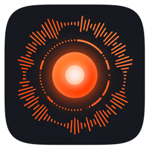
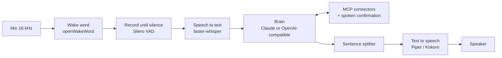

# Hey Spark

*by [ContextuAI](https://contextuai.com)*

[](https://github.com/contextuai/hey-spark/actions/workflows/pr-checks.yml)
[](LICENSE)


**An always-listening voice assistant for your laptop.** Say *"Hey Spark"*, ask a question or
give a command, and hear the answer. The wake word, speech recognition and voice all run
locally on your CPU. The brain is Claude, [Hermes Agent](https://github.com/NousResearch/hermes-agent),
or any OpenAI-compatible model, including a local one through Ollama. Spark reaches your tools (GitHub, Gmail, Calendar, your own systems) through
[MCP](https://modelcontextprotocol.io) servers, and it asks out loud before doing anything that
changes something.

<!-- TODO: demo GIF of the desktop window (docs/media/demo.gif) -->

> *"Hey Spark, what's on my calendar tomorrow?"*
> *"Set a pasta timer for ten minutes."*
> *"Summarize the open pull requests on hey-spark."*
> *"Let's start a new project called weather-bot."* → *"I'll create a folder, a git repo and a private GitHub repo called weather-bot. Should I go ahead?"*

## Features

- **Local wake word.** A bundled [openWakeWord](https://github.com/dscripka/openWakeWord) model
  for "Hey Spark". [Train your own wake word](docs/wakeword.md) for free in Google Colab, or use
  Picovoice Porcupine.
- **Local speech.** [faster-whisper](https://github.com/SYSTRAN/faster-whisper) speech-to-text and
  [Piper](https://github.com/rhasspy/piper) or [Kokoro](https://github.com/thewh1teagle/kokoro-onnx)
  text-to-speech, all CPU-only. Deepgram and ElevenLabs are optional cloud backends.
- **Your choice of brain.** Claude through the
  [Claude Agent SDK](https://pypi.org/project/claude-agent-sdk/), your own
  [Hermes Agent](https://github.com/NousResearch/hermes-agent), or any OpenAI-compatible API:
  OpenAI, Azure OpenAI, OpenRouter, Groq, Together, Ollama, LM Studio or vLLM.
- **Connectors over MCP**, with per-server allowlists. Read-only tools run freely; anything that
  sends, creates or updates needs a **spoken "yes"**, and destructive tools are blocked by default.
- **Conversation that feels natural.** Spark streams its answer sentence by sentence, stays awake
  for follow-ups without the wake word, ignores speech that isn't meant for it, and can be
  interrupted by saying the wake word (barge-in).
- **A personality of your choice.** Plain and brief by default, or a composed British butler
  with a dry wit who calls you "sir", answers the wake word with "Yes, sir?" and speaks in a
  British voice. See [Personality and voice](docs/persona.md).
- **Memory and shortcuts.** It keeps editable Markdown notes about each connected system, and you
  can map a short phrase ("good morning") to a detailed prompt.
- **Desktop app** for macOS and Windows: a single Start/Stop button, a light that shows what
  Spark is doing, and windows for Connectors, Shortcuts, the Brain, and Personality & Voice.
- **Everything is swappable from `config.yaml`**: wake word, VAD, STT, TTS and brain backends,
  with no code changes.

## How it works



Nothing leaves your machine before the wake word. After it, only the text of your request goes
to the brain you chose. Audio leaves the machine only if you pick a cloud STT backend.

## Quick start

**Requirements:** macOS 14 or later on Apple Silicon, or Windows 11 (see
[Platform support](#platform-support)), a microphone, about 1 GB of disk for models, and a brain:
[Claude Code](https://code.claude.com/docs/en/setup) signed in to your Claude account (or with an
[Anthropic API key](https://console.anthropic.com/)), an OpenAI-compatible key, or
[Ollama](https://ollama.com) running locally. A USB speakerphone with echo cancellation works
best.

### Option A: download the app

Get the latest build from [Releases](https://github.com/contextuai/hey-spark/releases). Each file
has a `.sha256` checksum next to it.

**macOS** (Apple Silicon, macOS 14+)

1. Download `HeySpark-<version>-macos-arm64.dmg`, open it and drag **HeySpark** into
   **Applications**.
2. Open it from Applications. If macOS says it can't verify the app, open
   *System Settings → Privacy & Security*, scroll down and click **Open Anyway**. (Or run
   `xattr -dr com.apple.quarantine /Applications/HeySpark.app` once in Terminal.)
3. Allow microphone access when macOS asks.

Settings, logs, models and your `.env` live in `~/Library/Application Support/HeySpark`.

**Windows** (Windows 11)

1. Download and run `HeySpark-Setup-<version>.exe`. It installs per-user and needs no admin
   rights. The installer isn't code-signed yet, so Windows SmartScreen may warn you: choose
   *More info → Run anyway*.
2. Open **Hey Spark** from the Start menu.

Settings, logs, models and your `.env` live in `%LOCALAPPDATA%\HeySpark`.

**Then, on either platform:**

1. Click the **brain** button, pick a provider and enter
   your key (or pick Ollama).
2. Press **Start**. The first start downloads the speech models (about 200 MB). Then say
   *"Hey Spark"*.

### Option B: from source

```bash
# 1. Install uv (https://docs.astral.sh/uv/); it manages Python 3.11 for you
git clone https://github.com/contextuai/hey-spark.git
cd hey-spark
uv sync --all-extras                 # plain `uv sync` skips the optional backends

# 2. Download the speech models into ./.models (about 200 MB)
uv run spark models download

# 3. Add your brain's key
cp .env.example .env                 # (Windows: copy) then set your key; see "Choose a brain"

# 4. Check everything, then talk to it
uv run spark doctor                  # every required check should show ✔
uv run spark                         # say "Hey Spark, what's the capital of Japan?"
```

No microphone handy? `uv run spark --text` lets you type questions and read answers, and
`uv run spark --brain mock --text` runs fully offline with no key at all.

## Choose a brain

| Brain | Set up | Good for |
|---|---|---|
| **Claude** (default) | [Claude Code](https://code.claude.com/docs/en/setup) installed and signed in (or `ANTHROPIC_API_KEY` in `.env`) | The best tool use and connector work. Supports the researcher sub-agent and fast/deep model routing |
| **Hermes Agent** | [Hermes Agent](https://github.com/NousResearch/hermes-agent) with its API server on, and its `API_SERVER_KEY` | Giving your Hermes agent a voice: it answers with its own model, tools, memory and skills |
| **OpenAI-compatible cloud** (OpenAI, Azure, OpenRouter, Groq, Together) | The provider's key in `.env`, and `brain.backend: openai_compat` | Using a model or account you already have |
| **Local** (Ollama, LM Studio, vLLM) | Run the server, pull a tool-capable model (e.g. `qwen2.5:7b`) | **Fully local**: with faster-whisper and Piper, nothing leaves your machine |

The easiest way to switch is the desktop app's **Brain** window, which also tests the connection
and checks that the model can call tools. See [docs/openai_brain.md](docs/openai_brain.md) for the
provider presets and the `config.yaml` settings.

With Claude, `brain.mode` picks the models: `auto` (default) sends quick requests to
`brain.fast_model` and bigger ones to `brain.deep_model`; `deep` answers everything with
`brain.deep_model` and hands tool-heavy lookups to a researcher on a faster model (the best
answers, and the highest API cost). You can also switch by voice
("use the deep model", "back to auto").

## The wake word

The default `config.yaml` uses the bundled model `assets/wakewords/hey_spark.onnx`. Nothing to set
up. If it misses you or wakes on its own, tune `wakeword.options.openwakeword.threshold`.

**Want your own wake word?** [`tools/wakeword_trainer.ipynb`](tools/wakeword_trainer.ipynb) trains
one for any phrase on a free Colab GPU in about an hour, with no recordings needed.
[docs/wakeword.md](docs/wakeword.md) walks through it step by step, plus the Porcupine
alternative.

[](https://colab.research.google.com/github/contextuai/hey-spark/blob/main/tools/wakeword_trainer.ipynb)

## Talking to Spark

- **Follow-ups:** after a reply, Spark stays awake for 3 minutes (`attention.awake_s`), so you can
  keep talking without the wake word. It answers only speech that's meant for it, then plays a
  soft chime when it falls asleep.
- **Commands:** "new topic" (fresh conversation), "go to sleep", "never mind", and "mute
  yourself" (it then stops listening until you click the mic button in the window). Film-style
  ones work too: "stand down", "belay that", "clean slate protocol", "full power", "go dark".
- **Timers and time:** "set a pasta timer for 10 minutes", "what timers do I have", "what time is it".
- **New projects:** "let's start a new project called weather-bot". After your *yes*, Spark creates
  `projects.root_dir/weather-bot` with git and a first commit, a private GitHub repo and a tracking
  issue through your `gh` login (it never pushes), and can open Claude Code in the folder.
- **Shortcuts:** map a phrase like "good morning" to a detailed prompt in the Shortcuts window
  (or `shortcuts.json`). Fifteen come built in: "rise and shine" for the morning briefing,
  "what's next?", "sitrep", "check the post", "run a diagnostic", "house party protocol" and more.
  See [docs/commands.md](docs/commands.md).
- **Barge-in:** with `app.barge_in: true`, saying the wake word while Spark is talking stops it.
  Turn this on only with an echo-cancelling speakerphone.
- **Earcons:** a chime on wake, a tick while thinking, a low tone on errors.
- **Personality and voice:** pick the butler personality and a British voice in the Personality &
  Voice window (or `app.persona: butler` in `config.yaml`). See [docs/persona.md](docs/persona.md).

## Connectors and safety

Connectors are MCP servers defined in `mcp_servers.json` (with `${VAR}` placeholders only; the
values come from `.env`). Add them by hand or in the desktop app's **Connectors** window. Each
server's tool policy lives in `config.yaml` under `connectors:`:

- `allowed_tools` are read-only and pre-approved.
- `side_effecting` tools (send, create, update) need a **spoken "yes"** every time. Spark says one
  line about what it will do and waits. Silence, an unclear answer or "no" means it doesn't happen.
- `destructive` tools are blocked unless you set `allow_destructive: true` for that server.
- Any tool on none of these lists is denied.

### GitHub in two minutes

1. Create a [fine-grained token](https://github.com/settings/personal-access-tokens/new) for the
   repos Spark may see: *Issues: Read and write*, *Pull requests: Read* and *Contents: Read*.
2. In the **Connectors** window, open **github** (under *From config files*) and click **Edit
   config**. Replace `${SPARK_GITHUB_PAT}` with your token and press **Save and test**. Spark
   moves the token to `.env`.

   ```json
   {
     "github": {
       "type": "http",
       "url": "https://api.githubcopilot.com/mcp/",
       "headers": { "Authorization": "Bearer YOUR_TOKEN" }
     }
   }
   ```

3. Switch it on. Spark uses GitHub's own labels for the tools: reading runs freely, creating an
   issue asks you first, and deleting is off. Try *"What are the open issues in my-repo?"*

This is GitHub's official [github-mcp-server](https://github.com/github/github-mcp-server),
hosted by GitHub. GitHub's docs list Copilot access as a prerequisite for the hosted server
(Copilot has a free plan); if your account is refused, or you'd rather run it on your own
computer, see
[docs/connectors.md](docs/connectors.md). Paste the token itself: GitHub's VS Code example uses
`${input:...}`, a VS Code prompt that Spark can't show.

### Other connectors

Choose **Add connectors** in the Connectors window and paste any MCP server's JSON (the
`mcpServers` block from its README or from Claude Desktop), or import Claude Desktop's servers in
one click. [docs/connectors.md](docs/connectors.md) covers servers set up by hand in
`mcp_servers.json` and `config.yaml`, including Gmail, Google Calendar and Outlook through
Composio. The claude.ai Gmail and Calendar connectors are off by default: they work only through
a claude.ai login in your own Claude CLI, so they're for personal setups.

## Privacy

- Before the wake word, audio never leaves the wake-word detector, and no audio is stored unless
  you run with `--debug-audio`.
- After the wake word, your words are transcribed locally (unless you choose Deepgram) and the
  text goes to the brain you chose.
- Secrets live only in `.env` or the environment. A redaction filter masks them, and common token
  shapes, in every log line.
- Spark keeps local logs you can read and delete: transcripts (`logs/transcripts.log`, turn off
  with `logging.transcripts: false`) and an activity history (`history/`, see `activity:` in
  `config.yaml`). They never leave your machine.

## Configuration

Everything is in [`config.yaml`](config.yaml), and every key has a comment. Override any key per run
with an environment variable (`SPARK_<SECTION>__<KEY>`) or a CLI flag:

```yaml
wakeword: { backend: openwakeword }   # openwakeword | porcupine
stt:      { backend: faster_whisper } # faster_whisper | deepgram
tts:      { backend: kokoro }         # kokoro | piper | elevenlabs | print
brain:    { backend: claude_agent }   # claude_agent | openai_compat | mock
```

```powershell
$env:SPARK_STT__BACKEND = "deepgram"; uv run spark
uv run spark --stt deepgram --tts kokoro
```

<details>
<summary>All commands</summary>

```powershell
uv run spark                         # voice mode
uv run spark --text                  # type questions, print answers (no audio devices)
uv run spark --text --speak          # type questions, hear answers
uv run spark --no-tts                # voice in, printed answers out
uv run spark --debug-audio           # also save the last utterance to debug_audio/
uv run spark -v                      # debug logging (shows tool calls by name)
uv run spark desktop                 # the desktop window
uv run spark doctor                  # environment checks, each with a fix
uv run spark models download         # whisper + the configured voice (Kokoro George by default)
uv run spark bench stt|tts|brain     # latency benchmarks (median / p90)
uv run spark bench latency           # live: wake word to first audio, end to end
uv run spark bench false-wake --minutes 30   # live: count false wakes on background audio
```

Per-turn latency breakdowns are appended to `logs/latency.jsonl`.
</details>

## Platform support

| Platform | Status |
|---|---|
| **macOS 14+, Apple Silicon** | Desktop app (`.dmg`) and source. Every build is self-tested in CI. New in 0.1.0, so please report anything odd. |
| **Windows 11** | Desktop app (installer) and source. The platform Hey Spark was developed on (WASAPI audio). |
| Intel Macs, Linux | From source only, untested. The code is cross-platform Python; reports and pull requests are welcome. |

Everything runs on the CPU; no GPU is needed.

## Building the apps

**macOS** (on a Mac with the Xcode command-line tools):

```bash
bash scripts/build_macos.sh
```

This freezes the app into `build/dist/HeySpark.app`, signs it ad hoc, runs its self-test and
writes `build/installer/HeySpark-<version>-macos-arm64.dmg`. Set `MACOS_SIGN_IDENTITY` (plus
`APPLE_ID`, `APPLE_TEAM_ID` and `APPLE_APP_PASSWORD`) to sign with a Developer ID and notarize.

**Windows:**

```powershell
powershell -ExecutionPolicy Bypass -File scripts\build_windows.ps1
```

This freezes the app into `build\dist\HeySpark\HeySpark.exe`. With
[Inno Setup 6](https://jrsoftware.org/isinfo.php) installed (`winget install JRSoftware.InnoSetup`),
it also writes `build\installer\HeySpark-Setup-<version>.exe`.

Releases are built by GitHub Actions ([`build-apps.yml`](.github/workflows/build-apps.yml)), which
also builds both apps for pull requests that touch packaging or the desktop app.

## Development

```powershell
uv run pytest -q                     # offline suite: fakes and synthesized audio, about a minute
uv run pytest -q -m live             # hits real Claude / cloud APIs (needs keys)
uv run ruff check . && uv run ruff format --check .
```

The architecture in one line: every component is an abstract class in `spark/interfaces.py`, and
`spark/registry.py` maps the backend names in `config.yaml` to implementations. `spark/app.py`
is the state machine. [CONTRIBUTING.md](CONTRIBUTING.md) explains how to add a backend, run the
tests and send a pull request, and [docs/design/SPEC.md](docs/design/SPEC.md) is the original
design spec. Hardware checks that need a real mic are in
[docs/dev/MANUAL_QA.md](docs/dev/MANUAL_QA.md).

Hey Spark was built with [Claude Code](https://claude.com/claude-code). The project's agents and
skills are in [`.claude/`](.claude), and the original phase plans and reports are in
[docs/dev/history](docs/dev/history).

## Contributing and security

Contributions are welcome: see [CONTRIBUTING.md](CONTRIBUTING.md) and the
[Code of Conduct](CODE_OF_CONDUCT.md). Please report vulnerabilities privately as described in
[SECURITY.md](SECURITY.md). Release notes are in [CHANGELOG.md](CHANGELOG.md).

## License

The code is [MIT](LICENSE) © 2026 Nagendra Rao Jogi.

The bundled wake-word model (`assets/wakewords/hey_spark.onnx`) is licensed separately under
**CC BY-NC-SA 4.0** (non-commercial), because its training data has mixed licenses. See
[assets/wakewords/LICENSE](assets/wakewords/LICENSE). For commercial use, train your own model on
data you're licensed to use, or use Porcupine. Licenses for the dependencies and the downloaded
speech models are listed in [THIRD_PARTY_NOTICES.md](THIRD_PARTY_NOTICES.md).

---

Hey Spark is an open-source project from [ContextuAI](https://contextuai.com), makers of
[ContextuAI Solo](https://contextuai.com/solo).
