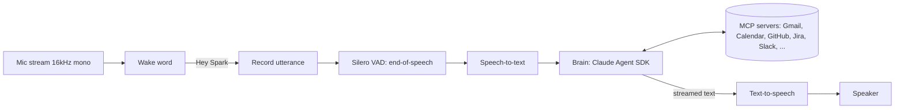

# Spark: Wake-Word Voice Assistant (Build Spec)

> **For Claude Code:** This is the source of truth for the project. Build it **one phase at a time**. Stop at the end of each phase, run the acceptance checks, and report results before starting the next phase. Ask before adding dependencies not listed here. Keep every component behind an interface so backends can be swapped through config.

---

## 1. What we're building

Spark is a Jarvis-style, always-listening voice assistant that runs on a laptop. You say **"Hey Spark"** (the wake word is configurable), ask a question or give a command, and Spark answers out loud. Behind the scenes it uses Claude, through the **Claude Agent SDK**, as the brain and **MCP servers** as connectors (email, calendar, GitHub, Jira, Slack, files, and so on).

Examples of what it should handle:

- "Hey Spark, what's on my calendar this afternoon?"
- "Hey Spark, what's the status of the open PRs on my repo?"
- "Hey Spark, any unread email from Sarah today?"
- "Hey Spark, let's start a new project called weather-bot." It confirms first, then scaffolds a repo and creates a tracking ticket.

### Goals
- Wake-to-first-spoken-word latency: **under 1.5 s** for simple questions (stretch target on CPU-only hardware; under 2 s is acceptable for Phase 1).
- Fully swappable backends for wake word, STT, TTS, and brain.
- Connectors are plain MCP servers, configured in one JSON file.
- Any action with side effects (sending, creating, deleting, writing) needs **spoken confirmation**.

### Non-goals (for now)
- No GUI in Phases 1–3. It is terminal-only, with rich logging. Phase 4 adds a minimal desktop window (§10).
- No multi-user voice identification.
- No always-on cloud streaming of audio. Audio leaves the machine only after the wake word fires, and only when a cloud STT backend is selected.

---

## 2. Target environment

| Item | Choice |
|---|---|
| Machine | A typical Windows 11 laptop: 4-core / 8-thread Intel CPU, integrated graphics (no NVIDIA GPU) |
| OS | **Windows 11 x64** (primary). Keep code cross-platform; no macOS-only dependencies in the default path |
| Python | 3.11+ |
| Package manager | `uv` |
| Audio I/O | `sounddevice` (PortAudio, WASAPI host API on Windows) |
| Mic | USB speakerphone with hardware echo cancellation (Jabra Speak or eMeet class) recommended |
| Claude Agent SDK | `claude-agent-sdk` (Python). It drives the Claude Code CLI, so confirm the CLI is available on Windows (see the SDK README) |
| Disk | Only ~40 GB free. Keep model downloads small and cache them in one configurable folder |

### CPU-only constraints (important)
- There is no CUDA. Every local model runs on CPU, so **prefer small, fast models** and measure latency before upgrading.
- The brain always stays on Claude. Local LLMs are out of scope on this hardware.
- The laptop may be locked down, so installs, always-on mic access, background processes, and outbound connections may be restricted by endpoint security. Add a `spark doctor` command (Phase 1) that checks mic access, model files, API reachability, and CLI availability, and prints clear fixes.

## 3. Architecture



### State machine

```
IDLE ──wake word──▶ LISTENING ──end of speech──▶ THINKING ──first sentence──▶ SPEAKING
  ▲                                                                                 │
  └──── follow-up window expires (8 s, no speech) ◀── FOLLOW_UP ◀── done speaking ─┘
```

- **FOLLOW_UP:** after Spark finishes speaking, keep listening for about 8 s without requiring the wake word, so the conversation feels natural.
- **Barge-in (Phase 3):** saying the wake word while Spark is speaking stops TTS immediately and returns to LISTENING.
- Play short earcons: a chime on wake, a soft tick when thinking starts, and an error tone on failure.

---

## 4. Components and default backends

Each component is an abstract base class in `spark/interfaces.py`. Concrete backends live in their own modules and are selected in `config.yaml`.

| Component | Interface | Default backend | Alternative backend(s) |
|---|---|---|---|
| Wake word | `WakeWordDetector.process(frame) -> bool` | **Porcupine** with a custom "Hey Spark" `.ppn` for Windows from Picovoice Console (needs `PICOVOICE_ACCESS_KEY`) | **openWakeWord** with a custom-trained model (fully open source) |
| VAD | `VAD.is_speech(frame) -> bool` | **silero-vad** | — |
| STT | `STT.transcribe(pcm) -> str` | **faster-whisper** on CPU, `compute_type="int8"`, model `base.en` (upgrade to `small.en` only if accuracy is poor and latency allows) | **Deepgram** streaming (cloud; fastest on this hardware, post-wake audio only); whisper.cpp with OpenVINO for Iris Xe acceleration (optional experiment) |
| Brain | `Brain.respond(text) -> AsyncIterator[str]` | **Claude Agent SDK** (`ClaudeSDKClient`) | — |
| TTS | `TTS.speak(text_chunks)` | **Piper** (local, very fast on CPU) | **Kokoro** via ONNX (better voice, slower on CPU; benchmark it); **ElevenLabs** (cloud) |

Note that the wake word backends want different frame sizes. Porcupine uses 512 samples and openWakeWord uses 1280 samples, both at 16 kHz. The audio module must handle this by re-chunking a ring buffer, not by assuming one frame size.

---

## 5. Project layout

```
spark/
├── pyproject.toml
├── config.yaml                # backend selection, thresholds, voices, models
├── mcp_servers.json           # connector definitions (see §7)
├── .env.example               # ANTHROPIC_API_KEY, PICOVOICE_ACCESS_KEY, ...
├── assets/
│   ├── wakewords/             # hey_spark.onnx (openWakeWord) / your own .ppn
│   └── sounds/                # wake.wav, thinking.wav, error.wav
├── spark/
│   ├── __main__.py            # `python -m spark`
│   ├── app.py                 # state machine + main async loop
│   ├── config.py              # pydantic settings (yaml + env)
│   ├── interfaces.py          # ABCs for all components
│   ├── audio/
│   │   ├── stream.py          # mic input, ring buffer, re-chunking
│   │   └── player.py          # interruptible playback
│   ├── wakeword/{porcupine.py, openwakeword.py}
│   ├── vad/silero.py
│   ├── stt/{faster_whisper.py, deepgram.py}
│   ├── tts/{piper.py, kokoro_onnx.py, elevenlabs.py}
│   ├── brain/
│   │   ├── claude_agent.py    # ClaudeSDKClient wrapper, streaming, hooks
│   │   ├── prompts.py         # voice system prompt
│   │   ├── router.py          # fast vs deep routing (Phase 3)
│   │   └── confirm.py         # spoken-confirmation hook for side effects
│   ├── tools/                 # in-process custom tools (time, timers, local status)
│   ├── doctor.py          # `python -m spark doctor` environment checks
│   └── util/{sentences.py, latency.py, logging.py}
└── tests/
    ├── audio_fixtures/        # recorded wavs: wake word, commands, silence, TV noise
    └── ...
```

---

## 6. Core loop (reference sketch)

This is the shape to implement. It is not final code.

```python
async def run(app: SparkApp):
    async for frame in app.mic.frames():
        match app.state:
            case State.IDLE:
                if app.wakeword.process(frame):
                    app.player.play_earcon("wake")
                    app.recorder.start()
                    app.state = State.LISTENING

            case State.LISTENING | State.FOLLOW_UP:
                app.recorder.add(frame)
                if app.recorder.end_of_speech(app.vad):        # silence > ~700 ms
                    text = await app.stt.transcribe(app.recorder.pcm())
                    if not text.strip():
                        app.state = State.IDLE
                        continue
                    app.state = State.THINKING
                    asyncio.create_task(app.handle_turn(text))

            case State.SPEAKING:
                if app.config.barge_in and app.wakeword.process(frame):
                    app.player.stop()
                    app.recorder.start()
                    app.state = State.LISTENING


async def handle_turn(self, text: str):
    chunks = self.brain.respond(text)                 # async stream of text deltas
    sentences = split_into_sentences(chunks)          # yield as each sentence completes
    self.state = State.SPEAKING
    await self.tts.speak(sentences)                   # start speaking on the first sentence
    self.state = State.FOLLOW_UP
```

---

## 7. Connectors (MCP)

### Key principle
Connectors added inside the Claude Desktop app **cannot be reused** by this program. There is no API into Desktop's session. Spark connects to the **same underlying MCP servers** directly. Desktop and Spark are two clients sharing the same backends.

### Config file: `mcp_servers.json`

This file is loaded at startup and passed to `ClaudeAgentOptions(mcp_servers=...)`.

```json
{
  "github": {
    "type": "stdio",
    "command": "npx",
    "args": ["-y", "@modelcontextprotocol/server-github"],
    "env": { "GITHUB_PERSONAL_ACCESS_TOKEN": "${GITHUB_TOKEN}" }
  },
  "aggregator": {
    "type": "http",
    "url": "${AGGREGATOR_MCP_URL}",
    "headers": { "Authorization": "Bearer ${AGGREGATOR_API_KEY}" }
  }
}
```

- Expand `${VAR}` values from the environment. Never commit secrets.
- Mix external servers with in-process SDK servers (`create_sdk_mcp_server`) for local tools such as the time, timers, and "what are you working on."
- Verify the exact config keys for remote (`http`/`sse`) servers against the current Agent SDK docs before relying on them.

### Getting breadth fast
Use an **MCP aggregator** (Composio, Zapier MCP, or Pipedream) for Gmail, Outlook/Microsoft 365, Google Calendar, Slack, Notion, and similar services. You get one endpoint with managed OAuth instead of many servers. Add direct servers (GitHub, filesystem, custom) alongside it.

### Auth spike (do this at the start of Phase 2)
Remote MCP servers authenticate differently: bearer header, API key, or an interactive OAuth flow. For each connector we plan to use, **verify how it authenticates when called from the Agent SDK outside of Claude Desktop**. Document the findings in `docs/connectors.md` before wiring more than two connectors.

### Tool permissions
- Build `allowed_tools` from config. Read-only tools are pre-approved.
- Any tool that sends, creates, updates, or deletes goes through the confirmation hook (§8.3).
- Start with an explicit allowlist per server. Don't expose everything by default.

---

## 8. Brain design

### 8.1 Session
- Use a long-lived `ClaudeSDKClient`, so follow-up questions keep context within a conversation.
- Reset the session after a configurable idle period (default 10 min), or when the user says "Spark, new topic."
- Put the model names in `config.yaml`:
  - `fast_model`: `claude-haiku-5-5`
  - `deep_model`: `claude-opus-5-5`

### 8.2 Voice system prompt (`brain/prompts.py`)
The system prompt tells the model it is speaking, not writing:
- Answer in 1–3 short spoken sentences unless asked for detail.
- No markdown, bullets, URLs, code, or emoji. Spell out symbols naturally.
- Summarize tool results. Don't read raw data, IDs, or long lists aloud. Offer "want the details?"
- If a request is ambiguous, ask one short clarifying question.
- Before any action with side effects, state exactly what will happen and ask "Should I go ahead?"

**Personality (`app.persona`, `spark/persona.py`).** A persona adds a section to this prompt and
words Spark's own fixed lines (the "On it" acknowledgement, command replies, "Should I go ahead?",
timer announcements, error lines). `standard` is the default and keeps the lines above. `butler`
is a composed British butler with a dry wit who calls the user `app.address_as` ("sir"), answers
the wake word out loud ("Yes, sir?", synthesized once at startup, `app.wake_reply`) and pairs
with a British Kokoro voice. A persona never relaxes a rule above. The desktop app sets it in the
Personality & Voice window (saved in `prefs.json`).

### 8.3 Spoken confirmation (`brain/confirm.py`)
- Use a **PreToolUse hook** that intercepts tools marked side-effecting in config.
- Spark speaks a one-line summary ("I'll create a GitHub repo called weather-bot. Go ahead?"), then listens for yes or no, with a timeout that counts as no.
- On no or timeout, deny the tool call with a reason the model can relay.

### 8.4 Routing (Phase 3)
- **Fast path:** status questions, lookups, small talk. Use `fast_model` with a limited tool set.
- **Deep path:** multi-step work ("let's start a new project", "summarize this week and draft a plan"). Use `deep_model` with the full tool set.
- Start with a simple rule-based or fast-model classifier, and log routing decisions.
- Deep tasks that take longer than about 5 s should get a spoken acknowledgment ("On it, give me a moment") and a spoken summary when done.

---

## 9. Latency budget (target for simple questions)

| Step | Budget |
|---|---|
| End-of-speech detection | ~700 ms of silence (tunable) |
| STT (local CPU, `base.en` int8, short utterance) | < 600 ms (measure; switch to Deepgram if consistently slower) |
| Brain time-to-first-token | < 600 ms (fast path) |
| TTS first audio chunk (Piper) | < 200 ms |

Techniques:
- Stream brain output.
- Split it into sentences and start TTS on the first complete sentence.
- Pre-load STT and TTS models at startup.
- Keep MCP servers warm.

Log a per-turn latency breakdown in `util/latency.py`.

---

## 10. Phases and acceptance criteria

### Phase 1: Voice round-trip (no connectors)
- Mic stream, wake word, VAD, STT, and Claude (no tools) feed Piper TTS.
- Earcons, FOLLOW_UP window, and config-driven backends are in place.
- **Accept when:**
  - "Hey Spark, what's the capital of Japan?" gets a spoken answer.
  - Median wake-to-first-audio latency is under 2 s over 10 trials on the laptop, with the breakdown logged.
  - `python -m spark doctor` passes on the target laptop.
  - There are fewer than 1 false wake in 30 minutes of TV or background noise.
  - STT and TTS backends can be swapped in `config.yaml` without code changes.

### Phase 2: Connectors
- Do the auth spike first (§7), then add `mcp_servers.json` loading, env expansion, allowlists, and the in-process local tools.
- Wire three connectors first: calendar, email, and GitHub.
- **Accept when:**
  - "What's on my calendar tomorrow?", "Any unread email from X?", and "How many open PRs on repo Y?" each give correct, spoken, summarized answers.
  - Nothing raw (IDs, URLs) is read aloud.

### Phase 3: Actions and routing
- Add the confirmation hook, fast/deep routing, and barge-in.
- Add the "start a new project" flow: create a local folder and git repo, create a GitHub repo, create a tracking task, and optionally open a Claude Code session in that folder.
- **Accept when:**
  - Every side-effecting action is confirmed by voice, and saying "no" prevents it.
  - Barge-in stops speech within 300 ms.

### Phase 4: Desktop app
Build for the desktop first (Windows now, macOS next). Other devices are deferred (see "Deferred" below).

- **Window.** One small window (about 360×540), no tray icon. Closing it quits the app and releases the mic. It is built with **pywebview** (the OS web view: Edge WebView2 on Windows, WebKit on macOS) around a single local HTML page (`spark/desktop/ui/index.html`, no network assets). It follows the OS light/dark theme.
- **Controls.** A single Start/Stop button. Start loads the models, connects the brain, and opens the mic. Stop cancels any turn, stops speech, and releases the mic, but keeps the models and brain loaded so the next Start is instant. The app opens stopped unless `desktop.autostart_listening: true`.
- **Indicator.** A central orb shows the state:
  - stopped: grey, "Stopped"
  - starting: slow spin, "Starting…" plus the current step (downloading models, loading models, connecting to Claude)
  - IDLE (armed): soft breathing glow, "Say "Hey Spark"", with a live mic-level ring so you can see it hears you
  - LISTENING / FOLLOW_UP: bright pulse, "Listening…"
  - THINKING: spinner, "Thinking…"
  - SPEAKING: ripple, "Speaking"
  - CONFIRMING: yellow, "Yes or no?"
  - error: red, one line with the fix (e.g. "Claude didn't accept the sign-in. Run claude in a terminal and type /login, or add an Anthropic API key in the Brain window.")
- **Last exchange.** Below the orb: the last thing you said and the last reply, both text. No history view.
- **Wiring.** `spark/desktop/controller.py` runs `SparkApp` on its own asyncio thread (PortAudio streams are opened on that loop's thread). It subscribes to `on_state`, forwards transcripts, and computes the mic level (RMS, throttled to about 15 Hz) through a wrapper around the mic input. The pipeline itself doesn't know the UI exists. pywebview owns the main thread.
- **User data.** A frozen (installed) app keeps its data in a per-user folder: `%LOCALAPPDATA%\HeySpark` on Windows (Local, not Roaming, because the models are about 200 MB), `~/Library/Application Support/HeySpark` on macOS. That folder holds `config.yaml`, `.env`, `mcp_servers.json`, `logs/`, `models/` and `assets/`, seeded from the bundled defaults on first run without overwriting user edits. Run from source, the app uses the repo's `config.yaml` as today.
- **First run.** If the speech models are missing, Start downloads them (whisper and the Piper voice, about 200 MB) with progress shown in the window.
- **Installer.** On Windows, PyInstaller (one folder, windowed) plus an Inno Setup per-user installer (`HeySpark-Setup-<version>.exe`, no admin rights). It adds a Start-menu shortcut and an uninstaller that leaves `%LOCALAPPDATA%\HeySpark` in place. The build is `scripts/build_windows.ps1`. macOS (`.app` plus `.dmg`, with a microphone usage string) is built later on a Mac from the same code.
- **Bundled backends.** The installer ships only the local backends: openWakeWord, Silero, faster-whisper, Piper and Kokoro (the butler's British voices; its ~340 MB model downloads only when a Kokoro voice is picked). The cloud and alternative backends (Deepgram, ElevenLabs, Porcupine) stay in the code as optional extras for source runs.
- **Single instance.** A second launch focuses the running window instead of opening a second mic.
- **Launch.** `uv run python -m spark desktop` from source; the installed app launches the same entry point.
- **Accept when:**
  - The installer runs on the laptop without admin rights and puts Hey Spark in the Start menu.
  - From a fresh user folder, the first Start downloads the models and reaches "Say "Hey Spark"".
  - Every state shows its own indicator. The mic-level ring moves when you talk in IDLE.
  - Stop releases the mic: the Windows mic-in-use indicator goes away within 1 s, and Start again reaches IDLE in under 2 s.
  - Closing the window quits the process, with no leftover `python`/`Hey Spark` process.
  - The offline test suite covers the controller (with fakes), user-data seeding, and the single-instance check without opening a real window.

### Phase 5: All-day co-worker
Spark runs all day like a junior colleague: you talk to it when you need something, it stays with you while you're working together, it remembers what you did, and it goes off to do work and reports back. Task list and decisions: `docs/dev/history/PHASE5_TODO.md`.

- **Awareness.** After a reply Spark stays **awake** for `attention.awake_s` (default 180 s) and hears requests with no wake word. After that much silence it goes to **sleep** (soft chime), and the wake word is needed again. "Go to sleep", "new conversation", "stop" and similar commands are handled locally, without Claude. While awake, each utterance first passes an "is this for me?" check. Chatter, filler and talk to other people are ignored silently and do not keep Spark awake.
- **Conversations.** Each wake starts a fresh Claude conversation; the user never sees the break. The next session is prepared in the background when Spark goes to sleep. Each session starts with a briefing: the memory summary, plus the previous conversation's last exchanges if it ended within `attention.carry_over_s`.
- **Activity log (audit).** Everything is appended to a per-day JSONL log: what was said, routing, tool calls (redacted inputs), full tool results, confirmations, commands, ignored speech and errors. It is hash-chained and redacted. It is kept on disk with no time limit (`activity.retention_days: 0`) and never edited; only the user deletes from it ("forget"). Past conversations feed future briefings and memory.
- **Memory.** Markdown files the user can read and edit (`me.md`, projects, connector notes, a daily journal). Each entry records the conversation it came from. Every conversation ends with a background title and summary.
- **History.** A History window shows a timeline of conversations: search, details, export, forget, and continue from here. "Go back to …" works by voice too.
- **Delegation.** "Go do X" becomes a background task (Claude Code in a project folder, or a deep connector query) with a persisted ledger. Spark reports back with a chime, a window card, and speech when you're free. Background tasks never commit, push, or write outside their project folder on their own.
- **Working-day polish.** Pause while another app is using the mic (calls), and recover from mic, sleep/resume and CLI failures.
- **Accept when:**
  - After a reply, a follow-up 2 minutes later needs no wake word; after 3 minutes of silence Spark is asleep.
  - Background talk while awake is ignored and logged as ignored.
  - "Go to sleep" sleeps immediately; "new conversation" starts a fresh session without calling Claude.
  - A wake within 30 min of the last conversation can answer "what was that number again?".
  - Every turn, tool call and confirmation appears in the activity log, and the hash chain verifies.
  - "Remember that …" survives a restart. The History window shows and searches past conversations, and "forget" removes one.
  - A delegated task runs while the conversation continues, is listed by "what are you working on", and its result is reported.

### Deferred (decide later)
- Other devices: a Raspberry Pi 5 or ESP32-S3 satellite that runs only the wake word and audio, streaming to the laptop or a home server over a websocket.

---

## 11. Testing
- **Unit tests:** use recorded wav fixtures for the wake word (positives and negatives), VAD endpointing, and STT accuracy on 10 sample commands.
- **Brain tests:** use a `MockBrain` for state-machine tests, plus a recorded-transcript test that checks the voice prompt rules (no markdown in output).
- **CLI flags:**
  - `--text` mode skips audio: type input and print output.
  - `--no-tts` prints responses instead of speaking.
  - `--debug-audio` saves the last utterance to disk. This is off by default.

---

## 12. Security and privacy
- Keep secrets in `.env` or the OS keychain. Never log them.
- No audio is stored by default. Transcripts are logged locally with rotation, and logging can be disabled.
- Audio leaves the machine only after the wake word, and only if a cloud STT backend is selected.
- Keep tool allowlists per server. Destructive tools are off unless explicitly enabled.
- Connecting work or school systems (such as Outlook through Microsoft Graph) may require tenant admin consent for the app registration and scopes. Start read-only.

---

## 13. Open decisions
- Final wake word: **"Hey Spark"** (a custom openWakeWord model; train your own with `tools/wakeword_trainer.ipynb`).
- Aggregator choice: Composio, Zapier MCP, or Pipedream (decide after the Phase 2 auth spike).
- TTS voice: Kokoro's George (`bm_george`) is the default, downloaded on first run (~340 MB).
  It costs about 0.9 s per sentence on a laptop CPU against Piper's 0.15 s. Piper stays available
  in config.yaml; its voices are no longer offered in the window (every British male one is
  fine-tuned from the research-only `lessac`).
- STT: stay local (`base.en` vs `small.en`) or switch to Deepgram, based on Phase 1 latency numbers.
- Whether to add a speech-to-speech fast path (OpenAI Realtime or Gemini Live) for small talk in Phase 4.

---

## 14. Working agreement for Claude Code
1. Read this whole file before writing code, and restate the Phase 1 plan in 5–10 bullets.
2. Scaffold the layout and interfaces first. Then implement one backend per component.
3. Add each dependency with `uv add` and explain why. Don't add unlisted dependencies without asking.
4. Write tests alongside code. Run them before declaring a phase done.
5. At the end of each phase, report the acceptance checklist with pass/fail and the latency numbers. Then stop.
